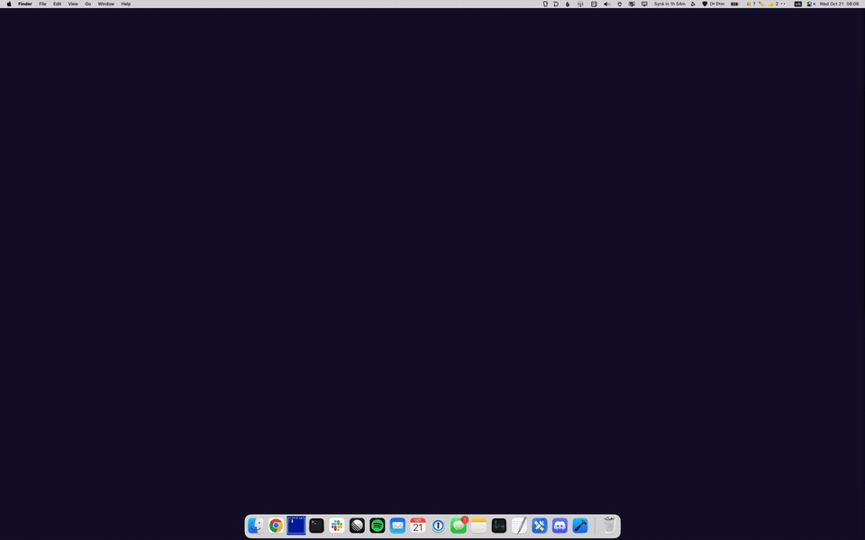

# BoxedDock

A dock replacement for macOS with a cool switcher feature, press F20 to activate (I have capslock mapped to F20 with Karabiner).

## Usage

Pressing F20 dims the whole screen and shows the running apps with their names underneath. Press F20 again or Escape to close it.

- **Type to switch:** start typing an app name. The typed part of each matching name is highlighted, and non-matching apps fade out. As soon as only one app matches, BoxedDock switches to it. Enter switches to the first match.
- **Click to switch:** clicking an icon switches to that app.
- **Quick-access slots:** below the apps there are nine numbered slots. Drag an app icon into a slot, then type its number to jump straight to that app, launching it if it isn't running. You can also click a slot. Drag between slots to rearrange them, and right-click a slot to remove its app. The slots are remembered between launches.

Because digits are used for the slots, digits at the start of an app name are skipped when typing: 1Password is found by typing `p`. The skipped digits are drawn semi-transparent. "Microsoft " and "Google " are also dropped from the start of names, so Google Chrome is just Chrome.

## Configuration

The order of the apps is set by the `sortOrder` list at the top of `BoxedDock/ContentView.swift`. Apps in that list come first, in that order, and the rest follow in the order they were launched. The hotkey is registered in `BoxedDock/AppDelegate.swift`.

## Building

Open `BoxedDock.xcodeproj` in Xcode and build. It needs macOS 12 or later.
